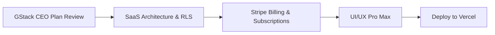

# 🚀 Cookbook 1: Zero-to-Production SaaS in One Afternoon

Learn how to chain skills from the **Universal AI Agent Skills Library** to architect, build, monetize, and deploy a production-grade multi-tenant B2B SaaS platform.

---

## 🔗 Skill Chain



| Step | Skill to Activate | Purpose |
|:---:|:---|:---|
| **1** | `gstack-plan-ceo-review` | Pressure-test value proposition, user journey, and edge cases. |
| **2** | `saas-multi-tenancy-architecture` | Design PostgreSQL Row-Level Security (RLS) schemas and organization boundaries. |
| **3** | `saas-billing-and-stripe` | Implement Stripe Checkout, Customer Portal, Webhook idempotency, and metered usage. |
| **4** | `ui-ux-pro-max` | Generate high-conversion, accessible, modern frontend components. |
| **5** | `deploy-to-vercel` | Configure environment variables, serverless route handlers, and CI deployment. |

---

## 🛠️ Step-by-Step Implementation

### Step 1: Strategic Alignment (`gstack-plan-ceo-review`)
Instruct your agent:
```markdown
Run a GStack CEO Review on my SaaS concept: [Description]. Identify monetization risks, unnecessary features, and the highest-leverage MVP scope.
```

### Step 2: PostgreSQL Row-Level Security (`saas-multi-tenancy-architecture`)
Enforce multi-tenancy at the database level rather than application level:
```sql
ALTER TABLE projects ENABLE ROW LEVEL SECURITY;

CREATE POLICY tenant_isolation_policy ON projects
  FOR ALL
  USING (organization_id = current_setting('app.current_org_id')::uuid);
```

### Step 3: Production Stripe Webhook Idempotency (`saas-billing-and-stripe`)
```typescript
import { stripe } from "@/lib/stripe";
import { headers } from "next/headers";

export async function POST(req: Request) {
  const body = await req.text();
  const signature = headers().get("Stripe-Signature") as string;
  const event = stripe.webhooks.constructEvent(body, signature, process.env.STRIPE_WEBHOOK_SECRET!);

  switch (event.type) {
    case "checkout.session.completed":
      await handleSubscriptionCreated(event.data.object);
      break;
    case "customer.subscription.deleted":
      await handleSubscriptionRevoked(event.data.object);
      break;
  }
  return new Response(JSON.stringify({ received: true }), { status: 200 });
}
```

### Step 4: High-Conversion UI/UX (`ui-ux-pro-max`)
Ask the agent:
```markdown
Using ui-ux-pro-max and clean-minimalist styling, create a responsive pricing tier card component with monthly/annual toggle and Stripe Checkout links.
```

### Step 5: Production Deployment (`deploy-to-vercel`)
Deploy in seconds:
```bash
npx universal-agent-skills add deploy-to-vercel
vercel --prod
```
