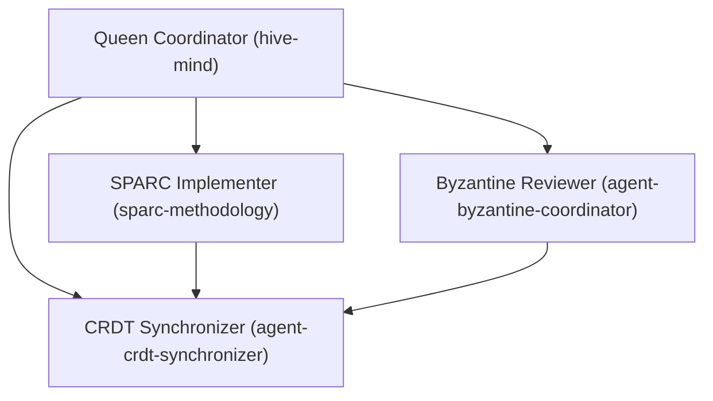

# 🌊 Cookbook 3: Multi-Agent Swarm Collaboration & Consensus

Deploy autonomous multi-player agent swarms powered by **Ruflo**, **SPARC methodology**, and **Byzantine Fault Tolerance** to coordinate complex coding projects.

---

## 🔗 Skill Chain



| Agent Role | Skill to Activate | Mission |
|:---|:---|:---|
| **Swarm Leader** | `hive-mind` | Task decomposition, role assignment, and progress tracking across subagents. |
| **Autonomous Coder** | `sparc-methodology` | Execute autonomous coding via Specification → Pseudocode → Architecture → Refinement → Completion. |
| **Consensus Verifier** | `agent-byzantine-coordinator` | Audit code against hallucinations, verifying multi-agent consensus before landing. |
| **Conflict Resolver** | `agent-crdt-synchronizer` | Resolve concurrent file edits without merge conflicts using CRDT operations. |

---

## 🛠️ Step-by-Step Implementation

### Step 1: Initialize Swarm Topology
```markdown
Activate hive-mind and orchestrate a 3-agent swarm:
- Agent 1 (Planner): Define technical requirements and interfaces.
- Agent 2 (SPARC Coder): Implement features test-first.
- Agent 3 (Reviewer): Validate code quality, edge cases, and typing.
```

### Step 2: The SPARC Autonomous Cycle
The Coder agent follows the 5-phase SPARC engineering contract:
1. **Specification**: Exact mathematical definition of inputs, outputs, and constraints.
2. **Pseudocode**: Language-agnostic algorithmic flow.
3. **Architecture**: Module structure, dependencies, and interfaces.
4. **Refinement**: Test-driven implementation with strict type annotations.
5. **Completion**: All tests passing 100%, zero lint or formatting errors.

### Step 3: Byzantine Consensus Validation
Before merging any PR or landing code:
- Minimum quorum required (2/3 majority approval).
- Tests must pass deterministically across all environments.
